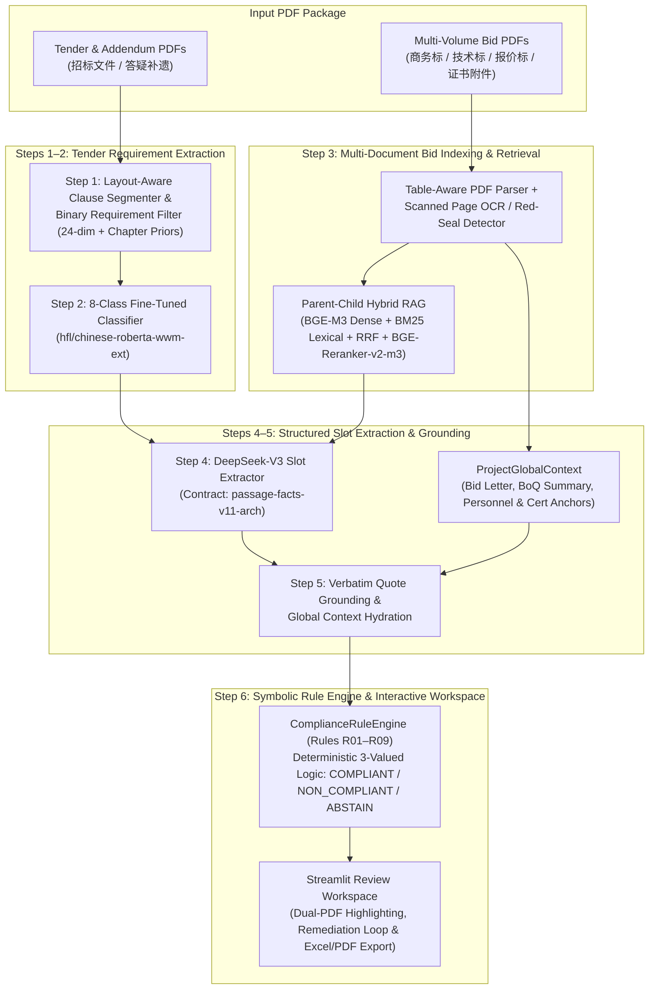

# TenderCheck — Neuro-Symbolic Intelligent Bid Compliance Review System

**TenderCheck** is an end-to-end **Neuro-Symbolic Machine Reasoning System** for automated compliance verification of Chinese engineering tender (招标文件) and bid (投标文件) packages.

Instead of relying on unconstrained end-to-end LLM judgment—which suffers from numerical hallucination, cross-table entity confusion, and unverifiable citations in hundreds-of-pages engineering bids—**TenderCheck** decouples **neural perception & structured slot extraction** from **deterministic symbolic rule execution**:

1. **Neural Perception & Retrieval (Steps 1–4)**: Segments raw PDFs, filters out non-requirement boilerplate, classifies clauses into 8 compliance categories (`chinese-roberta-wwm-ext`), retrieves multi-volume bid evidence via Parent-Child Hybrid RAG (`BGE-M3` + `BM25` + `BGE-Reranker-v2-m3`), and extracts typed constraint/evidence slots (`DeepSeek-V3` under the `passage-facts-v11-arch` contract).
2. **Anti-Hallucination Grounding & Global Context Hydration (Step 5)**: Verifies every extracted number, unit, entity binding, and conflict pair against verbatim PDF substrings (`ground_extraction`) and hydrates cross-chapter project anchors (`ProjectGlobalContext`).
3. **Symbolic Compliance Rule Engine (Step 6)**: Executes 9 deterministic, auditable compliance rules (`R01`–`R09`) to output three-valued verdicts (`COMPLIANT`, `NON_COMPLIANT`, `ABSTAIN`) with full reasoning traces and page-level PDF highlights.

---

## 1. System Architecture (Six-Stage Pipeline)



---

## 2. Core Modules, Models & Benchmark Performance

Every stage of the pipeline is independently evaluated on real Chinese engineering tender/bid datasets (71 annotated tender projects for Steps 1–2, and the full 359-clause **S604 Wannan Traffic-Tourism Highway Project** with 22 bid & attachment PDFs for Steps 3–6):

| Stage | Module | Model / Algorithm | Dataset / Benchmark | Key Metrics |
| :--- | :--- | :--- | :--- | :--- |
| **Step 1** | Tender Clause Segmentation & Binary Filtering | Layout/Table PDF Segmenter + 24-Feature `LogisticRegression` (`BinaryRequirementFilter`) | 71 Tender Projects (`130,507` train / `18,278` val / `37,500` test candidates) | In-Domain Test Acc: **`96.54%`**, ROC-AUC: **`0.9790`**<br/>S604 End-to-End Gold Recall: **`94.13%`** (`61.2%` noise removed) |
| **Step 2** | 8-Category Requirement Classification | Fine-tuned `hfl/chinese-roberta-wwm-ext` (`MaxLen=256`, `fp16`) | `28,195` annotated clauses across 8 classes + 2 unseen holdout projects | In-Domain Test Acc: **`98.21%`**, Macro-F1: **`0.9728`**<br/>Holdout Projects Acc: **`96.73%`**, Macro-F1: **`0.9435`** |
| **Step 3** | Parent-Child Hybrid Bid RAG | `BAAI/bge-m3` + Domain `BM25` + RRF + `BAAI/bge-reranker-v2-m3` | S604 50-Clause Retrieval Benchmark (`2,262` child chunks, `847` parent sections) | Document Hit@5: **`98.0%`**<br/>Page Hit@5: **`94.0%`**, Page MRR: **`0.8583`** |
| **Step 4** | Structured Slot Extraction | `DeepSeek-V3` (`deepseek-chat`, `temperature=0.0`) under `passage-facts-v11-arch` | S604 50-Clause Extraction Benchmark (`196` constraint slots, `134` evidence slots) | Raw LLM Constraint Acc: **`82.14%`**, Evidence Acc: **`82.84%`**<br/>Unknown Abstention Rate: **`96.49%`** |
| **Step 5** | Verbatim Grounding & Global Hydration | `ground_extraction` + `ProjectGlobalContext` (`hydrate_with_global_context`) | S604 50-Clause Extraction Benchmark (Post-Grounding & Hydration) | Constraint & Evidence Slot Acc: **`100.0%`**<br/>Citation Support: **`100.0%`**, Hallucination Rate: **`0.0%`** |
| **Step 6** | Symbolic Compliance Rule Engine | Deterministic Python Rule Engine (`R01`–`R09`) | 88-Case Positive/Negative Unit Suite + S604 Full 359-Clause Replay | Unit Test Pass Rate: **`100.0%` (`88/88`)**<br/>S604 Full Replay: **`359/359`** (`281` Compliant, `6` Real Defects, `72` Routed Abstentions) |

### The 9 Symbolic Compliance Rules (`R01`–`R09`)
- **`R01_NUMERIC_BOUND`**: Numeric upper/lower/equality bounds, unit normalization (`万元`/`元`, `日历天`/`天`, `%`), and secondary bounds.
- **`R02_QUALIFICATION_LEVEL`**: Corporate & personnel qualification hierarchy (`特级 > 一级 > 二级 > 三级`), major/domain verification, subject ownership binding, and statutory certificate validity against `review_reference_date`.
- **`R03_ENTITY_CONSISTENCY`**: Chinese uppercase RMB amount (`壹贰叁...`) to Arabic numeral deterministic parser & cross-table entity consistency.
- **`R04_DOCUMENT_PRESENCE_AND_SEAL`**: Mandatory document body verification and multi-party seal/signature check routing.
- **`R05_PROHIBITION_AND_COMMITMENT`**: Red-line prohibition checks, cross-passage factual contradiction detection (`conflict_pairs`), and external credit website check routing.
- **`R06_QUALITATIVE_OR_SCORING`**: Objective numeric bracket scoring, multi-year highway credit grade matrix scoring, and subjective technical scoring routing.
- **`R07_STAFFING_COUNT_AND_QUALIFICATION`**: Role headcount (`AT_LEAST_N_QUALIFIED`), per-person certificate/title verification, and validity checks.
- **`R08_PERFORMANCE_CHAIN_AND_SCORING`**: Historical project performance multi-condition filtering (completion window, construction type, highway grade, mileage, contract amount, engineering scope, and role-handover approval).
- **`R09_FORMULA_BOUND`**: Multi-field financial ratio verification (e.g., Chapter 100 Safety Production Fee $\ge 1.5\%$ of net Chapters 100–700 BoQ base).

---

## 3. Repository Structure

```text
TenderCheck/
├── README.md                          # Project overview, architecture & quickstart guide
├── requirements.txt                   # Root Python dependencies
├── docs/                              # Architecture & evaluation documentation
│   ├── evidence_reasoning.md          # End-to-end neuro-symbolic reasoning & S604 replay summary
│   ├── rule_inventory_and_contracts.md# Formal specification of Rules R01–R09 & slot contracts
│   ├── rag_reproduction.md            # Hybrid RAG indexing & evaluation guide
│   ├── extraction_rules_plan.md       # Step 4–5 slot extraction & grounding design
│   └── TenderCheck_Frontend_Design.md # Streamlit Review Workspace UI architecture
└── SystemCode/                        # Core implementation, models, benchmarks & Streamlit app
    ├── README.md                      # Detailed developer & reproduction CLI reference
    ├── requirements.txt               # Core ML & rule engine dependencies
    ├── requirements-app.txt           # Streamlit frontend dependencies
    ├── requirements-rag.txt           # Hybrid RAG & local model dependencies
    ├── train_binary_filter.py         # Step 1: Train & evaluate BinaryRequirementFilter
    ├── train_classifier.py            # Step 2: Train & evaluate 8-class RoBERTa classifier
    ├── run_rag_pipeline.py            # Step 3: Build & query Parent-Child Hybrid Bid RAG
    ├── evaluate_evidence_rag.py       # Step 3: Evaluate RAG retrieval metrics (Hit@K, MRR)
    ├── evaluate_extraction.py         # Steps 4–5: Evaluate LLM slot extraction & grounding on 50-clause benchmark
    ├── evaluate_rule_engine.py        # Step 6: Run 88-case symbolic rule engine evaluation suite
    ├── replay_compliance_responses.py # Steps 4–6: Full 359-clause S604 replay & audit report generator
    ├── data/                          # Annotated datasets, benchmarks, caches & RAG indices
    ├── models/                        # Saved model checkpoints (roberta_wwm_ext, binary_filter)
    ├── reports/                       # JSON/Markdown evaluation reports for Steps 1–6
    ├── src/                           # Source packages (parsing, classification, retrieval, extraction, rules, app)
    └── tests/                         # Automated unit & integration test suites
```

---

## 4. Quickstart Guide

### 4.1 Environment Setup & Model Weights (Google Drive)

```bash
# 1. Create and activate Python 3.10+ environment
conda create -n tendercheck python=3.11 -y
conda activate tendercheck

# 2. Install core and frontend dependencies
pip install -r SystemCode/requirements.txt
pip install -r SystemCode/requirements-app.txt
```

#### Downloading Pre-Trained & Fine-Tuned Model Checkpoints
Because full neural network weights (`model.safetensors`, ~400 MB) exceed GitHub's 100 MB file limit, the trained model checkpoints are hosted on **Google Drive**:

- **Google Drive Download Link**: *(Paste Google Drive shared folder link here before final submission)*
- After downloading, place the model folders under `SystemCode/models/` as follows:
  ```text
  SystemCode/models/
  ├── binary_filter/
  │   ├── config.json
  │   └── binary_filter_pipeline.joblib      # Step 1: Trained 24-feature binary filter
  └── roberta_wwm_ext/
      ├── classifier_meta.json
      ├── config.json
      ├── tokenizer.json
      ├── tokenizer_config.json
      └── model.safetensors                  # Step 2: Fine-tuned 8-class RoBERTa weights
  ```
  *(Note: Even if the Google Drive weights are not yet downloaded locally, the S604 359-clause workspace and all Step 4–6 evaluations run out-of-the-box using the committed caches and built-in structural fallback.)*

#### Configuring DeepSeek API Key (for Live PDF Uploads)
To run live LLM slot extraction on newly uploaded projects, configure your DeepSeek API key (either as an environment variable or in `SystemCode/.env`):

```bash
# Linux / macOS
export DEEPSEEK_API_KEY="sk-..."

# Windows PowerShell
$env:DEEPSEEK_API_KEY="sk-..."
```
*(Note: Replaying the 359-clause S604 project or running the 50-clause extraction benchmark uses the committed extraction cache and works completely offline without an API key.)*

---

### 4.2 Launching the Streamlit Review Workspace

```bash
streamlit run SystemCode/src/app/app.py
```

The workspace supports two primary workflows:
1. **One-Click S604 Real Project (359 Clauses, 22 PDFs)**:
   - Click **"Load S604 Real Project"** on the welcome screen to inspect all 359 clauses, including real detected bid non-compliances (e.g., `T0056` 1095-day schedule violation vs. 360-day limit, `T0010`/`T0045` proposed Project Manager ongoing-project conflict, `T0096` missing joint-venture power of attorney) and financial formula verification (`T0192` Safety Production Fee calculation).
2. **New Project — Upload Custom Tender & Bid PDFs**:
   - Create a new project on the welcome screen, upload your Chinese **Tender PDF(s)** and **Bid PDF(s)** in **Step 1**, and click **"Confirm documents & start review pipeline"** in **Step 2** to execute automated clause segmentation, binary filtering, 8-class RoBERTa classification, bid RAG indexing, global context hydration, DeepSeek slot extraction, and `R01`–`R09` rule verification.
   - Open **Step 3 · Review Workspace** to inspect side-by-side tender/bid PDF page highlights, send defects to **Remediation**, and export **Excel Compliance Matrices** or **PDF Audit Reports**.

---

## 5. Reproducing Step 1–6 Evaluations

All commands below are run from the `SystemCode/` directory (`cd SystemCode`):

```bash
# Step 1: Train & evaluate Binary Requirement Filter (71 projects)
python train_binary_filter.py

# Step 2: Evaluate fine-tuned 8-class chinese-roberta-wwm-ext classifier
python train_classifier.py --eval_only

# Steps 4–5: Evaluate LLM Slot Extraction, Verbatim Grounding & Global Context (50-clause benchmark)
python evaluate_extraction.py --hydrate-global-context

# Step 6: Evaluate Symbolic Rule Engine R01–R09 (88-case positive/negative unit suite + 50-clause benchmark)
python evaluate_rule_engine.py

# End-to-End S604 Full 359-Clause Neuro-Symbolic Replay
python replay_compliance_responses.py \
  --cases reports/rag_experiments/s604_full359_reasoning_inputs/cases.json \
  --raw-dir reports/rag_experiments/s604_full359_reasoning_deepseek \
  --output-dir reports/rag_experiments/s604_full359_replay_v3 \
  --review-date 2022-11-11

# Run automated unit tests
python -m unittest tests/test_compliance_rules.py tests/test_compliance_reference.py tests/test_rule_contracts_and_suite.py tests/test_extraction_benchmark_and_eval.py
```

For detailed CLI options and module internals, see [`SystemCode/README.md`](SystemCode/README.md) and the technical documents in [`docs/`](docs/).
