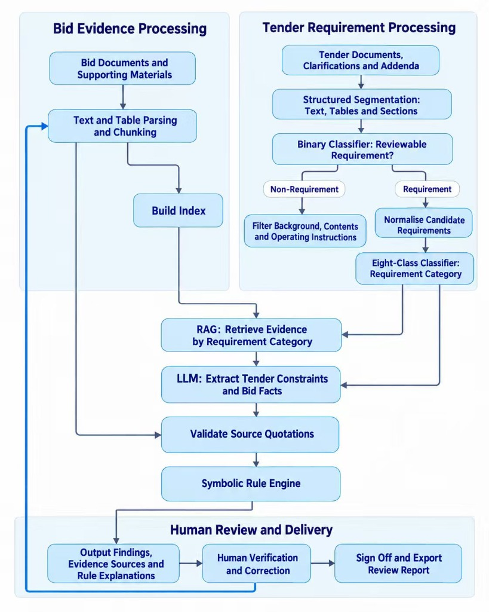

## SECTION 1 : PROJECT TITLE
## TenderCheck — Neuro-Symbolic Intelligent Bid Compliance Review System

<p align="center">
  
</p>

---

## SECTION 2 : EXECUTIVE SUMMARY / PAPER ABSTRACT

In large-scale Chinese engineering procurement, tender documents (招标文件) and multi-volume bid packages (投标文件) routinely span hundreds to thousands of pages across commercial, legal, technical, and Bill-of-Quantities (BoQ) volumes. A single overlooked mandatory requirement—such as an expired safety production license, an unsealed bid appendix, a mismatched uppercase/lowercase RMB bid price, or a subtle cross-chapter contradiction—can result in immediate bid disqualification (废标) and severe financial loss. Traditional manual review is slow, error-prone, and difficult to audit under tight submission deadlines, while end-to-end Large Language Models (LLMs) suffer from numerical hallucinations, cross-table entity confusion, and unverifiable citations when applied directly to long engineering PDFs.

To address these challenges, our team developed **TenderCheck**, an end-to-end **Neuro-Symbolic Intelligent Bid Compliance Review System** that decouples **neural perception & structured slot extraction** from **deterministic symbolic rule execution**:
1. **Neural Perception & Retrieval (Steps 1–4)**: Segments raw tender PDFs while preserving table layouts, filters out non-requirement boilerplate via a 24-feature `BinaryRequirementFilter` (`LogisticRegression`), classifies actionable clauses into 8 domain categories using a fine-tuned `chinese-roberta-wwm-ext` model, retrieves traceable multi-volume bid evidence via a **Parent-Child Hybrid RAG Pipeline** (`BGE-M3` dense embeddings + domain `BM25` + `BGE-Reranker-v2-m3` with category-guided routing), and extracts typed constraint and evidence slots using `DeepSeek-V3` under the `passage-facts-v11-arch` schema contract.
2. **Anti-Hallucination Grounding & Global Context Hydration (Step 5)**: Verifies every extracted number, unit, entity binding, and conflict pair against verbatim PDF substrings (`ground_extraction`) and hydrates cross-chapter project anchors (`ProjectGlobalContext`), eliminating unsupported LLM inferences before rule reasoning.
3. **Symbolic Compliance Rule Engine & Interactive Workspace (Step 6)**: Executes 9 deterministic, auditable compliance rules (`R01`–`R09`) to produce three-valued verdicts (`COMPLIANT`, `NON_COMPLIANT`, `ABSTAIN`) with step-by-step reasoning chains and page-level PDF highlights inside an interactive **Streamlit Review Workspace** supporting human-in-the-loop verification, bid text remediation with automatic re-evaluation, and two-sheet Excel Compliance Matrix export.

### Stage-by-Stage Benchmark Performance Summary

Every module is independently evaluated on real Chinese engineering tender/bid datasets (71 annotated tender projects for Steps 1–2, and the full 359-clause **S604 Wannan Traffic-Tourism Highway Project** with 22 bid & attachment PDFs for Steps 3–6):

| Stage | Module | Model / Algorithm | Dataset / Benchmark | Key Metrics |
| :--- | :--- | :--- | :--- | :--- |
| **Step 1** | Tender Clause Segmentation & Binary Filtering | Layout/Table PDF Segmenter + 24-Feature `LogisticRegression` (`BinaryRequirementFilter`) | 71 Tender Projects (`130,507` train / `18,278` val / `37,500` test candidates) | In-Domain Test Acc: **`96.54%`**, ROC-AUC: **`0.9790`**<br/>S604 End-to-End Gold Recall: **`94.13%`** (`61.2%` noise removed) |
| **Step 2** | 8-Category Requirement Classification | Fine-tuned `hfl/chinese-roberta-wwm-ext` (`MaxLen=256`, `fp16`) | `28,195` annotated clauses across 8 classes + 2 unseen holdout projects | In-Domain Test Acc: **`98.21%`**, Macro-F1: **`0.9728`**<br/>Holdout Projects Acc: **`96.73%`**, Macro-F1: **`0.9435`** |
| **Step 3** | Parent-Child Hybrid Bid RAG | `BAAI/bge-m3` + Domain `BM25` + RRF + `BAAI/bge-reranker-v2-m3` | S604 50-Clause Retrieval Benchmark (`2,262` child chunks, `847` parent sections) | Document Hit@5: **`98.0%`**<br/>Page Hit@5: **`94.0%`**, Page MRR: **`0.8583`** |
| **Step 4** | Structured Slot Extraction | `DeepSeek-V3` (`deepseek-chat`, `temperature=0.0`) under `passage-facts-v11-arch` | S604 50-Clause Extraction Benchmark (`196` constraint slots, `134` evidence slots) | Raw LLM Constraint Acc: **`82.14%`**, Evidence Acc: **`82.84%`**<br/>Unknown Abstention Rate: **`96.49%`** |
| **Step 5** | Verbatim Grounding & Global Hydration | `ground_extraction` + `ProjectGlobalContext` (`hydrate_with_global_context`) | S604 50-Clause Extraction Benchmark (Post-Grounding & Hydration) | Constraint & Evidence Slot Acc: **`100.0%`**<br/>Citation Support: **`100.0%`**, Hallucination Rate: **`0.0%`** |
| **Step 6** | Symbolic Compliance Rule Engine | Deterministic Python Rule Engine (`R01`–`R09`) | 88-Case Positive/Negative Unit Suite + S604 Full 359-Clause Replay | Unit Test Pass Rate: **`100.0%` (`88/88`)**<br/>S604 Full Replay: **`359/359`** (`281` Compliant, `6` Real Defects, `72` Routed Abstentions) |

### The 9 Symbolic Compliance Rules (`R01`–`R09`)
- **`R01_NUMERIC_BOUND`**: Numeric upper/lower/equality bounds, unit normalization (`万元`/`元`, `日历天`/`天`, `%`), and secondary bounds.
- **`R02_QUALIFICATION_LEVEL`**: Corporate & personnel qualification hierarchy (`特级 > 一级 > 二级 > 三级`), major/domain verification, subject ownership binding, and statutory certificate validity against `review_reference_date`.
- **`R03_ENTITY_CONSISTENCY`**: Chinese uppercase RMB amount (`壹贰叁...`) to Arabic numeral deterministic parser & cross-table entity consistency.
- **`R04_DOCUMENT_PRESENCE_AND_SEAL`**: Mandatory document body verification and multi-party seal/signature check routing.
- **`R05_PROHIBITION_AND_COMMITMENT`**: Red-line prohibition checks, cross-passage factual contradiction detection (`conflict_pairs`), and external credit website check routing.
- **`R06_QUALITATIVE_OR_SCORING`**: Objective numeric bracket scoring, multi-year highway credit grade matrix scoring, and subjective technical scoring routing.
- **`R07_STAFFING_COUNT_AND_QUALIFICATION`**: Role headcount (`AT_LEAST_N_QUALIFIED`), per-person certificate/title verification, and validity checks.
- **`R08_PERFORMANCE_CHAIN_AND_SCORING`**: Historical project performance multi-condition filtering (completion window, construction type, highway grade, mileage, contract amount, engineering scope, and role-handover approval).
- **`R09_FORMULA_BOUND`**: Multi-field financial ratio verification (e.g., Chapter 100 Safety Production Fee $\ge 1.5\%$ of net Chapters 100–700 BoQ base).

---

## SECTION 3 : CREDITS / PROJECT CONTRIBUTION

| Official Full Name | Student ID (MTech Applicable) | Work Items (Who Did What) | Email (Optional) |
| :--- | :---: | :--- | :--- |
| **GUO ZICHUN** | A0355497L | **Parent-Child Hybrid Bid RAG Module**: Responsible for PDF text/table parsing, child-to-parent document chunking, index construction, and hybrid evidence retrieval combining `BM25`, `BGE-M3` semantic retrieval, and neural reranking with category-guided prioritization; constructed and verified the required-evidence-group retrieval evaluation benchmark with full document/page traceability. | guozichun@u.nus.edu |
| **TANG XIONGJIE** | A0353668N | **Streamlit Review Workspace Frontend & Requirement Annotation**: Completed tender requirement dataset annotation with source text and page verification; designed and implemented the end-to-end Streamlit web interface covering document upload, requirement browsing, side-by-side tender/bid PDF evidence inspection, human verification status routing, remediation workflow, and compliance matrix export. | xiongjietang@u.nus.edu |
| **WANG ZHENGYUAN** | A0351196B | **Symbolic Compliance Rule Engine (`R01`–`R09`) & Requirement Annotation**: Participated in tender requirement annotation; designed and implemented deterministic compliance rules covering completion periods, bid prices, and qualification levels; built unit test suites for typical cases, boundary values, and missing evidence; implemented explainable reasoning traces and human-review abstention routing. | zhengyuan.wang@u.nus.edu |
| **QI JUNNAN** | A0354719U | **LLM Structured Slot Extraction, Grounding & Requirement Annotation**: Participated in tender requirement annotation; developed the LLM-based structured slot extraction pipeline (`DeepSeek-V3`) to extract constraint and evidence fields (completion periods, prices, qualifications) with strict source citations and verbatim grounding for downstream symbolic rule verification. | junnan.qi@u.nus.edu |
| **LI JIANXIANG** | A0351244M | **Tender Clause Segmentation & Classification Models**: Responsible for the Step 1 24-feature `BinaryRequirementFilter` (`LogisticRegression`) and Step 2 8-category requirement classification model (`chinese-roberta-wwm-ext` fine-tuning), training data preparation, hyperparameter optimization, and in-domain/holdout classification evaluation. | lijianxiang@u.nus.edu |

---

## SECTION 4 : VIDEO OF SYSTEM MODELLING & USE CASE DEMO

`Refer to system modelling and use case demo video at Github Folder: Video`

- **Folder Location**: [`Video/`](Video/)
- The presentation and system demonstration cover:
  1. **System Modelling & Technical Architecture**: How TenderCheck combines neural clause classification, Parent-Child Hybrid RAG, anti-hallucination slot grounding, and the `R01`–`R09` symbolic rule engine.
  2. **End-to-End Live Use Case Demo**: Creating a review project, uploading tender and bid PDFs, running automated neuro-symbolic compliance verification, inspecting side-by-side PDF evidence, remediating non-compliant clauses with live re-evaluation, and exporting the Excel Compliance Matrix.

---

## SECTION 5 : USER GUIDE

`Refer to appendix <Installation & User Guide> in project report at Github Folder: ProjectReport`

### 5.1 Environment Setup & Model Weights (Google Drive)

```bash
# 1. Create and activate Python 3.10+ environment
conda create -n tendercheck python=3.11 -y
conda activate tendercheck

# 2. Install all dependencies (ML, RAG, Rule Engine & Streamlit UI)
pip install -r requirements.txt
```

#### Downloading Pre-Trained & Fine-Tuned Model Checkpoints
Because full neural network weights (`model.safetensors`, ~400 MB) exceed GitHub's 100 MB file limit, the trained model checkpoints are hosted on **Google Drive**:

- **Model Weights (Google Drive)**: [https://drive.google.com/drive/folders/1cz9LNph8wSEhkGyagAS3LvDgFOKYCfOd?usp=drive_link](https://drive.google.com/drive/folders/1cz9LNph8wSEhkGyagAS3LvDgFOKYCfOd?usp=drive_link)
- After downloading, place the model folders under `SystemCode/models/` as follows:
  ```text
  SystemCode/models/
  ├── binary_filter/
  │   ├── config.json
  │   └── binary_filter_pipeline.joblib      # Step 1: Trained 24-feature binary filter
  ├── roberta_wwm_ext/
  │   ├── classifier_meta.json
  │   ├── config.json
  │   ├── tokenizer.json
  │   ├── tokenizer_config.json
  │   └── model.safetensors                  # Step 2: Fine-tuned 8-class RoBERTa weights
  └── pretrained/                            # Step 3: Local dense embedding & reranker weights
      ├── bge-m3/
      └── bge-reranker-v2-m3/
  ```

#### S604 Real-World Tender & Bid Dataset (Google Drive)
- **S604 Project Package (Google Drive)**: [https://drive.google.com/file/d/1mqYmapAIKs0HrO5bH-0CABvPrrAW6Ccs/view?usp=drive_link](https://drive.google.com/file/d/1mqYmapAIKs0HrO5bH-0CABvPrrAW6Ccs/view?usp=drive_link)
- **Access Note**: Because the S604 package comes from a proprietary corporate/personal engineering bidding project, access is protected on Google Drive and will be granted upon submitting an access request through the link above. Once downloaded and extracted, you can create a new project in the web workspace and upload the S604 tender, addendum, and bid PDFs directly to inspect the full review workflow.

#### Configuring DeepSeek API Key
To run LLM slot extraction (`DeepSeek-V3`) and generate remediation suggestions, configure your DeepSeek API key (either as an environment variable or in `.env` in the repository root):

```bash
# Linux / macOS
export DEEPSEEK_API_KEY="sk-..."

# Windows PowerShell
$env:DEEPSEEK_API_KEY="sk-..."
```

### 5.2 Launching the Streamlit Review Workspace

```bash
streamlit run SystemCode/src/app/main.py --server.maxUploadSize 1024
```

Workflow in the web interface (`http://localhost:8501`):
1. **Create a Review Project (`New project`)**:
   - Enter a project name on the home screen and click **Create project** to initialize a new workspace.
2. **Upload & Confirm Documents (`Overview · Step 1`)**:
   - Upload your **Tender PDF(s)**, **Addendum / Clarification PDF(s)**, and **Bid PDF(s)** (such as the S604 tender and bid PDFs downloaded from the Google Drive folder above), and verify their parsing status in the document table.
3. **Run the Automated Compliance Pipeline (`Overview · Step 2 & Step 3`)**:
   - Click **Confirm documents & start review pipeline** to execute clause segmentation, binary filtering, 8-class RoBERTa classification, Parent-Child Hybrid RAG indexing & retrieval, global context hydration, DeepSeek slot extraction, and `R01`–`R09` symbolic rule evaluation.
4. **Inspect Evidence, Remediate & Export (`Review Workspace` / `Remediation` / `Report & Export`)**:
   - Click **Open Review Workspace** to inspect side-by-side tender and bid PDF highlights, review structured `Field / Bid response / Result` comparisons, edit non-passing bid pages with automatic re-evaluation in **Remediation**, and export the two-sheet **Excel Compliance Matrix** in **Report & Export**.

### 5.3 Reproducing Step 1–6 Evaluations

All commands below are run from the `SystemCode/` directory (`cd SystemCode`):

```bash
# Step 1: Train & evaluate Binary Requirement Filter (71 projects)
python train_binary_filter.py

# Step 2: Evaluate fine-tuned 8-class chinese-roberta-wwm-ext classifier
python train_classifier.py --eval_only

# Steps 4–5: Evaluate LLM Slot Extraction, Verbatim Grounding & Global Context (50-clause benchmark)
python evaluate_extraction.py --hydrate-global-context

# Step 6: Evaluate Symbolic Rule Engine R01–R09 (88-case positive/negative unit suite + 50-clause benchmark)
python evaluate_rule_engine.py

# End-to-End S604 Full 359-Clause Neuro-Symbolic Replay
python replay_compliance_responses.py \
  --cases reports/rag_experiments/s604_full359_reasoning_inputs/cases.json \
  --raw-dir reports/rag_experiments/s604_full359_reasoning_deepseek \
  --output-dir reports/rag_experiments/s604_full359_replay_v3 \
  --review-date 2022-11-11

# Run automated unit tests
python -m unittest tests/test_compliance_rules.py tests/test_compliance_reference.py tests/test_rule_contracts_and_suite.py tests/test_extraction_benchmark_and_eval.py
```

---

## SECTION 6 : PROJECT REPORT / PAPER

`Refer to project report at Github Folder: ProjectReport`

**Sections in Project Report / Paper ([`ProjectReport/`](ProjectReport/)):**
- Executive Summary / Abstract
- Business Problem Background & Market Research
- Project Objectives & Neuro-Symbolic System Architecture
- System Implementation:
  - Step 1: Tender PDF Parsing, Clause Segmentation & 24-Feature Binary Requirement Filtering
  - Step 2: 8-Category Fine-Tuned `chinese-roberta-wwm-ext` Classification
  - Step 3: Parent-Child Hybrid Bid RAG (`BGE-M3` + `BM25` + `BGE-Reranker-v2-m3`)
  - Step 4 & Step 5: Structured LLM Slot Extraction (`DeepSeek-V3`), Anti-Hallucination Verbatim Grounding & Global Context Hydration
  - Step 6: Deterministic Symbolic Compliance Rule Engine (`R01`–`R09`) & Interactive Streamlit Review Workspace
- System Performance, Ablation Studies & S604 End-to-End Validation
- Conclusions, Limitations & Future Improvements
- Appendices:
  - Project Proposal
  - Mapped System Functionalities against Machine Reasoning (MR) Knowledge, Techniques & Skills
  - Installation & User Guide
  - Individual Project Reflections

---

## SECTION 7 : MISCELLANEOUS

`Refer to Github Folder: Miscellaneous`

### Repository Structure Overview

```text
TenderCheck/
├── README.md                          # Official IRS-PM submission README (Sections 1–7)
├── requirements.txt                   # Python dependencies
├── SystemCode/                        # Core implementation, models, benchmarks & Streamlit app
│   ├── train_binary_filter.py         # Step 1: Train & evaluate BinaryRequirementFilter
│   ├── train_classifier.py            # Step 2: Train & evaluate 8-class RoBERTa classifier
│   ├── run_rag_pipeline.py            # Step 3: Build & query Parent-Child Hybrid Bid RAG
│   ├── evaluate_evidence_rag.py       # Step 3: Evaluate RAG retrieval metrics (Hit@K, MRR)
│   ├── evaluate_extraction.py         # Steps 4–5: Evaluate LLM slot extraction & grounding
│   ├── evaluate_rule_engine.py        # Step 6: Run 88-case symbolic rule engine evaluation suite
│   ├── replay_compliance_responses.py # Steps 4–6: Full 359-clause S604 replay & audit report
│   ├── data/                          # Annotated datasets, benchmarks & evaluation annotations
│   ├── reports/                       # JSON/Markdown evaluation reports for Steps 1–6
│   ├── src/                           # Source packages (parsing, classification, retrieval, extraction, rules, app)
│   └── tests/                         # Automated unit & integration test suites
├── ProjectReport/                     # Project Report & Installation/User Guide documentation
├── Video/                             # System Modelling & Use Case Demo video
└── Miscellaneous/                     # Architecture diagram & requirement annotation schema
    ├── system_architecture.jpg        # System architecture diagram
    └── TenderCheck_Annotation/        # 8-category annotation guideline, schema & gold examples
```
